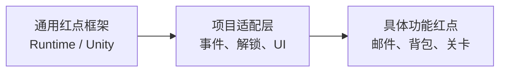
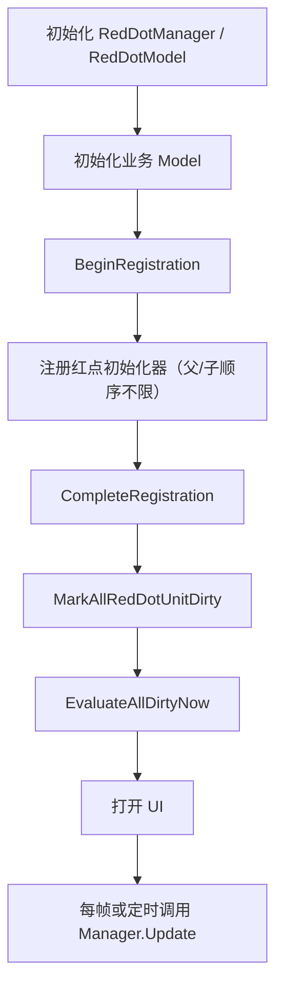

# 红点系统接入与新增指南

## 先分清三层职责

红点系统不是一整块必须整体复制的业务代码，可以分成三层理解：



### 通用红点框架

目录：

- `Assets/RedDot/Runtime`
- `Assets/RedDot/Unity`
- `Assets/RedDot/Editor`，可选
- `Assets/RedDot/Tests`，可选

职责：

- 管理红点名和运算单元。
- 保存运算单元结果。
- 调度脏单元计算。
- 汇总节点结果。
- 管理订阅和快照推送。
- 提供 Unity `RedDotWidget`。

`RedDot.Runtime` 没有业务程序集依赖，可以独立迁移。

### 项目适配层

当前示例中的对应代码：

- `GameRedDotHandler`
- `GameDynamicRedDotHandler`
- `GameFuncRDInitializer`
- `SystemRDInitializer`
- `GameStartupPipeline`
- `GameModuleManager`

这些代码负责连接项目自己的事件系统、模块生命周期和系统解锁逻辑，不是红点 Runtime 的必需部分。

### 具体功能红点

例如：

- `MailRDInitializer`
- `MailUIPublicMailRDH`
- `RedDotNames`
- `RedDotUnit`

每个功能只负责自己的节点、规则、数据和 UI 挂载。

## 一、当前项目新增一个红点

### 0. 先填写红点台账

新增红点前，先把下面几项写清楚：

| 项目 | 示例 |
|---|---|
| 显示位置 | 主界面“商店”按钮 |
| 红点名 | `MAIN_UI_MENU|SHOP` |
| 父红点名 | `MAIN_UI_MENU` |
| 运算单元 | `SHOP_NEW_GOODS_NUM` |
| 数据来源 | `ShopModel.NewGoodsNum` |
| 触发事件 | `EventId.ShopNewGoodsNumUpdate` |
| 显示类型 | `RedDotType.NUMBER` |
| 清除条件 | 新商品数量变成 0 |

只要这张表能闭环，新增红点通常不会迷路。

### 1. 定义红点名

红点名建议集中定义，不要散落在业务代码里。

父节点用 `|` 表示：

```csharp
public static class RedDotNames
{
    public const string MAIN_UI_MENU = "MAIN_UI_MENU";

    // 父节点由 MAIN_UI_MENU 的命名层级派生。
    public const string MAIN_UI_SHOP =
        MAIN_UI_MENU + "|SHOP";
}
```

规则：

- 父节点与子节点的注册顺序不限，模型会统一派生父子汇总关系。
- 子节点绑定运算单元时，默认会汇总到所有已注册父节点。
- 同一个红点名不能重复注册。

### 2. 定义运算单元

一个运算单元只表达一个最小影响因素：

```csharp
public static class RedDotUnit
{
    public const string SHOP_NEW_GOODS_NUM =
        "SHOP_NEW_GOODS_NUM";
}
```

规则：

- 一个单元只能有一个全局定义和一个计算函数。
- 如果两个功能语义不同，不要复用同一个单元名。
- 多个因素影响一个红点时，应定义多个单元。
- 当前聚合方式是“所有单元结果相加”。

例如：

```text
SHOP_NEW_GOODS_NUM = 3
SHOP_CLAIMABLE_REWARD_NUM = 2

SHOP 节点结果 = 3 + 2 = 5
```

### 3. 业务数据变化后派发事件

红点不直接监听 UI 点击，它监听业务数据变化。

```csharp
public class ShopModel : BaseModel<ShopModel>
{
    public int NewGoodsNum { get; private set; }

    public void SetNewGoodsNum(int count)
    {
        count = count >= 0 ? count : 0;
        if (NewGoodsNum == count)
        {
            return;
        }

        NewGoodsNum = count;
        EventManager.Singleton.DispatchEvent(
            EventId.ShopNewGoodsNumUpdate,
            count);
    }
}
```

关键点：

- 只有数据真的变化时才派发事件。
- 不在这里直接控制 UI 显示或隐藏。
- 红点只关心最终业务结果。

如果目标项目没有事件系统，也可以在数据变化时直接标脏：

```csharp
RedDotManager.Singleton.MarkRedDotUnitDirty(
    RedDotUnit.SHOP_NEW_GOODS_NUM);
```

直接标脏更简单，但业务 Model 会依赖 RedDot Runtime。事件方式耦合更低，推荐用于正式项目。

### 4. 编写红点处理器

处理器负责两件事：

1. 把运算单元绑定到红点。
2. 监听业务事件并把运算单元标脏。

```csharp
public class ShopNewGoodsRDH : GameRedDotHandler
{
    protected override void InitRedDotDatas()
    {
        AddBindRedDotUnit(
            RedDotUnit.SHOP_NEW_GOODS_NUM,
            "商店新商品数量",
            CalculateNewGoodsNum,
            RedDotType.NUMBER);
    }

    protected override void AddAllEvents()
    {
        base.AddAllEvents();
        AddEvent(
            EventId.ShopNewGoodsNumUpdate,
            OnShopNewGoodsNumUpdate);
    }

    private void OnShopNewGoodsNumUpdate(BaseEvent evt)
    {
        RedDotManager.Singleton.MarkRedDotUnitDirty(
            RedDotUnit.SHOP_NEW_GOODS_NUM);
    }

    private int CalculateNewGoodsNum()
    {
        return ShopModel.Singleton.NewGoodsNum;
    }
}
```

处理器的计算函数必须读取“当前最新业务数据”，不能自己缓存一套红点值。

### 5. 编写红点初始化器

初始化器负责声明节点，并指定它使用哪个处理器。

```csharp
public class ShopRDInitializer : FuncRDInitializer
{
    protected override void InitRedDotInfos()
    {
        AddRedDotInfo<ShopNewGoodsRDH>(
            RedDotNames.MAIN_UI_SHOP,
            "主界面商店红点");
    }
}
```

父节点通常由父功能自己的初始化器声明，例如：

```csharp
AddRedDotInfo(
    RedDotNames.MAIN_UI_MENU,
    "主界面菜单红点");
```

子节点可以先于父节点注册。父节点后续注册时，模型会自动补齐父子汇总关系。

### 6. 在模块启动阶段注册初始化器

```csharp
public sealed class ShopModule : GameModuleBase
{
    public override string Name => "Shop";

    public override void Initialize()
    {
        ShopModel.Singleton.Init();
    }

    public override void RegisterRedDots(
        IRedDotRegistrar registrar)
    {
        registrar.Register(new ShopRDInitializer());
    }

    public override void Dispose()
    {
        ShopModel.Singleton.Dispose();
    }
}
```

然后把模块加入启动列表：

```csharp
new MainUIModule(MainUI),
new ShopModule(),
```

父节点和子节点的注册顺序可以互换。全部注册完成后，模型会统一构建父级有效单元和反向索引。

### 7. 在 UI 上指定红点名

使用 `RedDotWidget` 时，业务 UI 只负责指定红点名：

```csharp
ShopBtnWidget.SetRedDotName(
    RedDotNames.MAIN_UI_SHOP);
```

或者在 Prefab 上直接配置 `RedDotWidget` 的红点名。

不要手动写：

```csharp
redDotImage.gameObject.SetActive(count > 0);
```

显示和隐藏应由 `RedDotWidget` 根据快照自动完成。

### 8. 按顺序验证

建议按下面顺序验证：

1. 控制台是否打印重复节点或重复单元错误。
2. 红点可视化窗口里能否找到节点。
3. 运算单元页签里能否找到单元。
4. 单元计算结果是否等于 Model 中的业务值。
5. 节点结果是否是所有单元结果之和。
6. 数据变化后，单元是否进入脏队列。
7. 等待调度后，节点结果是否刷新。
8. `RedDotWidget` 是否订阅了完全相同的红点名。
9. 结果为 0 后，UI 是否收到新快照并隐藏。

可视化窗口入口：

```text
ToolsWindow → 红点系统 → 红点系统可视化窗口
```

## 二、接入另一个 Unity 项目

### 第一步：决定接入范围

#### 只需要计算和订阅

复制：

```text
Assets/RedDot/Runtime
```

适合：

- 不满足使用 uGUI。
- 项目要自己实现红点视图。
- 只使用 `IRedDotService`、`RedDotSnapshot` 和订阅。

#### 使用 uGUI 红点组件

复制：

```text
Assets/RedDot/Runtime
Assets/RedDot/Unity
```

另外保障项目安装了 `UnityEngine.UI`。

`RedDot.Unity.asmdef` 依赖：

```text
RedDot.Runtime
UnityEngine.UI
```

#### 需要调试工具

再复制：

```text
Assets/RedDot/Editor
Assets/RedDot/Tests
```

这两个目录不是运行时必需。

### 第二步：不要直接复制整套示例业务

这些代码是当前示例项目的适配层，不是通用框架：

- `GameLauncher`
- `GameStartupPipeline`
- `GameModuleManager`
- `GameRedDotHandler`
- `GameFuncRDInitializer`
- `SystemRDInitializer`
- 邮件、背包、关卡、活动模块

目标项目应当只保留框架，然后按照自己的架构实现适配层。

### 第三步：适配事件系统

当前通用框架的 `RedDotHandler` 不知道事件系统，这是刻意的：

```text
RedDot.Runtime
    ↑
项目事件适配层
    ↑
项目自己的 EventManager / EventBus / DI
```

如果目标项目已有事件系统，可以照当前项目的 `GameRedDotHandler` 写一个适配基类。

如果没有事件系统，可以简化为：

```csharp
public abstract class ProjectRedDotHandler : RedDotHandler
{
    // 项目没有事件系统时，可以暂时不实现事件绑定。
}
```

业务数据变化时直接调用：

```csharp
RedDotManager.Singleton.MarkRedDotUnitDirty(
    RedDotUnit.XXX);
```

### 第四步：接入启动流程

目标项目必须在打开相关 UI 前完成下面几步：

```csharp
// 1. 初始化红点 Runtime。
RedDotManager.Singleton.Init();
RedDotModel.Singleton.Init();

// 2. 初始化业务 Model。
InitializeBusinessModels();

// 3. 注册红点节点和运算单元。
var registrar = RedDotInitializer.Singleton;
registrar.BeginRegistration();

RegisterParentInitializers(registrar);
RegisterChildInitializers(registrar);

registrar.CompleteRegistration();

// 4. 立即完成首次计算，避免 UI 第一帧拿到旧数据。
RedDotManager.Singleton.MarkAllRedDotUnitDirty();
RedDotManager.Singleton.EvaluateAllDirtyNow();

// 5. 最后再打开界面。
OpenMainUI();
```

项目主循环需要持续调用：

```csharp
RedDotManager.Singleton.Update();
```

如果目标项目不是逐帧驱动，也可以用定时器、服务 Tick 或 Update 管理器调用。

### 第五步：处理关闭顺序

建议按照以下顺序释放：

```csharp
RedDotInitializer.Singleton.Dispose();
DisposeBusinessModules();
RedDotManager.Singleton.Dispose();
RedDotModel.Singleton.Dispose();
```

原因：

- 初始化器释放时会移除节点、单元和业务事件。
- 业务 Model 释放前应先停止对应红点规则。
- Manager 和 Model 最后由红点框架统一清理。

## 三、标准启动顺序



顺序中最容易出错的三个点：

1. **业务 Model 尚未初始化就开始绑定规则。**
2. **父节点最终缺失，或红点名层级拼接错误。**
3. **UI 已打开，但首次红点计算还没有完成。**

## 四、动态红点怎么接入

动态红点通常用于：

- 每个活动实例一个节点。
- 每个关卡实例一个节点。
- 临时排行榜或限时玩法。

动态节点仍然遵循同一原则：

1. 先创建红点名和处理器。
2. 处理器绑定动态运算单元。
3. 数据变化时标脏。
4. 节点移除时同步解除规则和事件。

当前示例中有两种动态方式：

- 关卡：按配置批量生成有限个动态节点。
- 活动：活动创建时注册，活动移除时删除。

不要用动态节点绕过重复注册错误。如果节点本来应该长期存在，应使用静态初始化器。

## 五、新增红点检查清单

- [ ] 红点名和父节点关系已定义。
- [ ] 父子节点均已注册，命名层级一致。
- [ ] 每个影响因素都有独立运算单元。
- [ ] 运算单元名称全局唯一。
- [ ] 计算函数读取的是最新业务数据。
- [ ] 数据变化会派发事件或直接标脏。
- [ ] 处理器正确绑定单元和事件。
- [ ] 初始化器注册了正确节点和处理器。
- [ ] 模块已经加入启动注册列表。
- [ ] UI 的 `RedDotWidget` 使用了完全一致的红点名。
- [ ] 启动阶段执行了首次全量计算。
- [ ] 主循环持续调用 `RedDotManager.Update()`。
- [ ] 结果为 0 时 UI 能正确隐藏。
- [ ] 销毁阶段按顺序释放初始化器、业务模块、Manager 和 Model。

## 六、常见问题定位

| 现象 | 优先检查 |
|---|---|
| 找不到红点节点 | 初始化器是否注册、节点名是否拼错 |
| 找不到运算单元 | 处理器是否执行 `AddBindRedDotUnit` |
| 单元一直不刷新 | 数据变化后是否派发事件或标脏 |
| 单元刷新但节点不变 | 节点是否真的绑定了该单元 |
| 子红点亮、父红点不亮 | 父节点是否已注册、名称层级是否正确 |
| 数据为 0 但红点不灭 | 事件、脏队列、调度帧数和订阅名 |
| UI 打开时不显示 | 首次全量计算是否在 UI 打开前完成 |
| UI 一直显示旧值 | 是否持续调用 Manager.Update |
| 重复节点或重复单元报错 | 名称是否被多个初始化器/处理器重复注册 |
| 关闭系统后报事件或节点错误 | 释放顺序和事件解绑是否正确 |

## 最小心智模型

新增一个红点时，只需要记住这条链：

```text
业务数据
    ↓
变化事件 / 直接标脏
    ↓
运算单元
    ↓
红点节点汇总
    ↓
RedDotSnapshot
    ↓
RedDotWidget 显示或隐藏
```

接入另一个项目时，只需要迁移中间的通用框架，再把前后两端替换成目标项目自己的业务数据和 UI。
