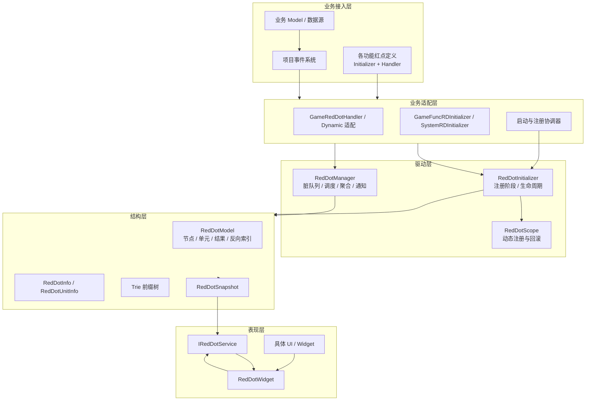
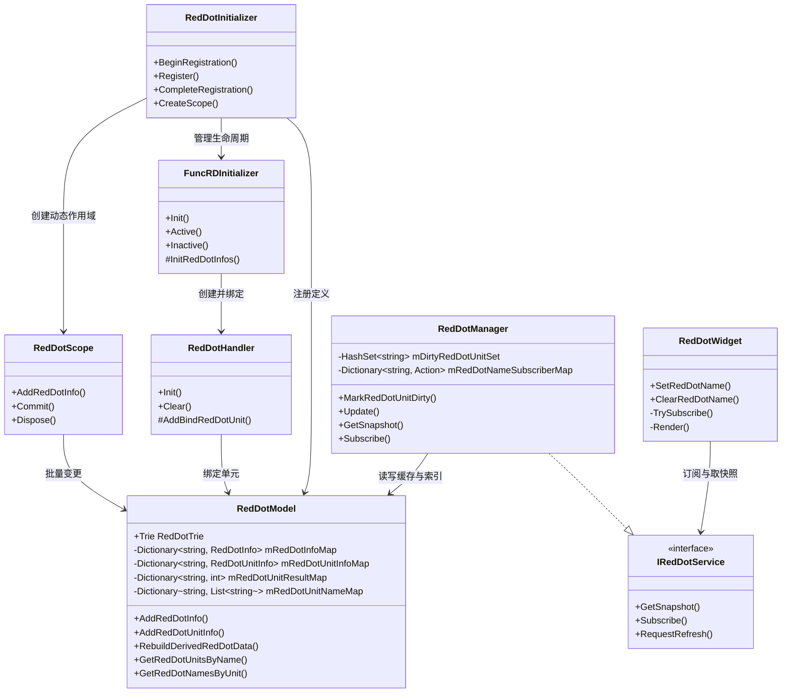
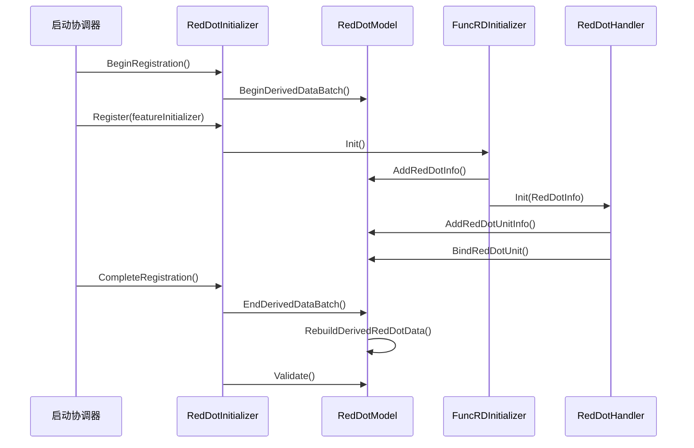
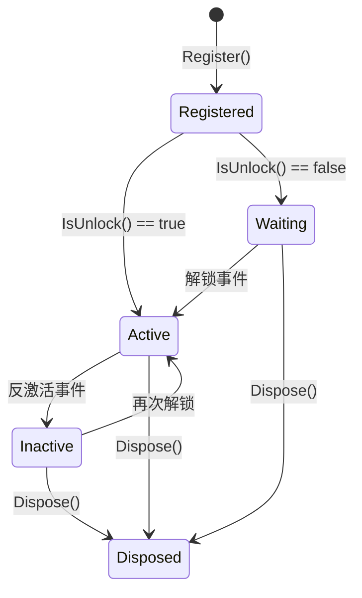
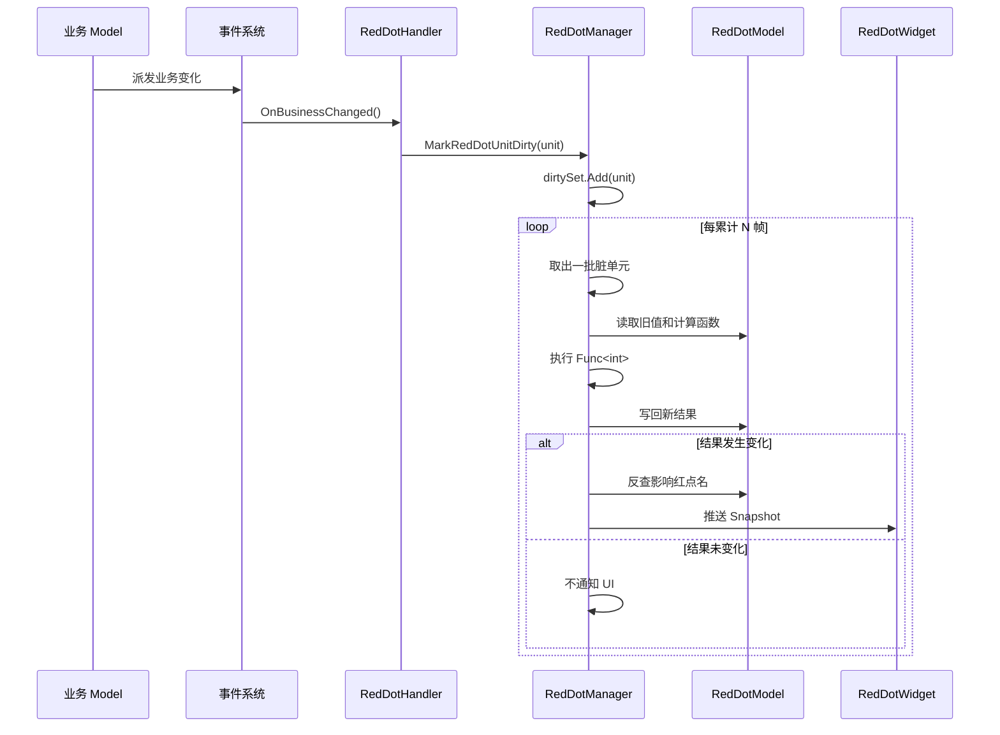
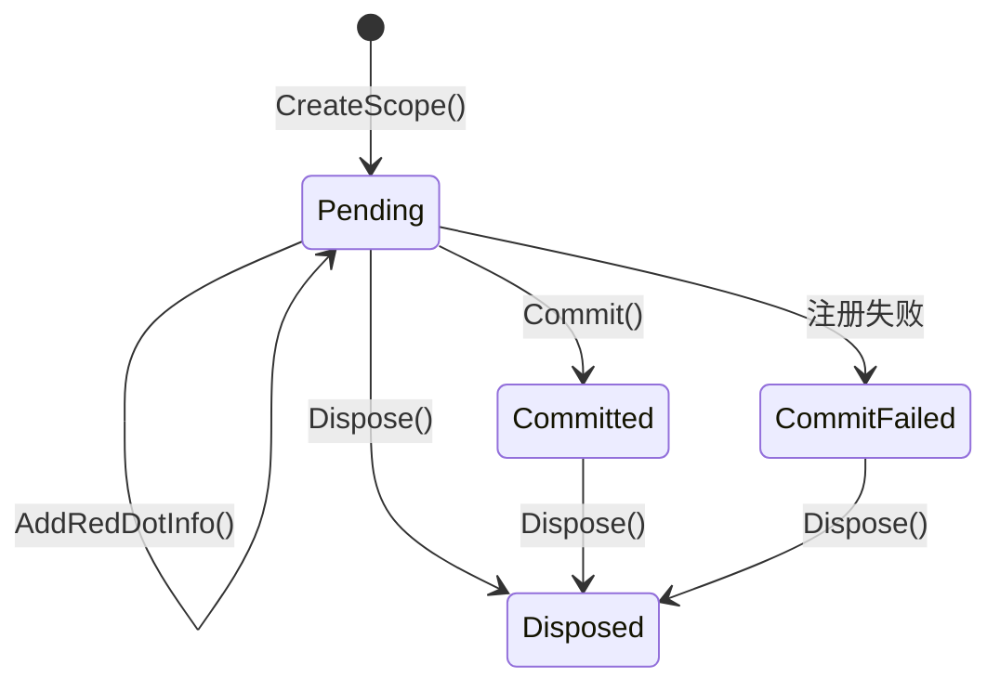
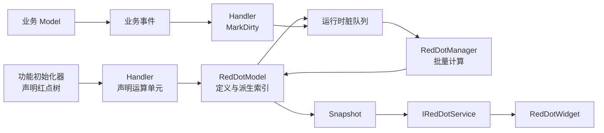

# 红点系统调研

> 调研对象：当前工程中的 `RedDot.Runtime`、`RedDot.Unity` 与业务适配层。
> 调研目标：从红点系统自身出发，分析问题背景、数据结构选型、整体架构、设计规范性与后续演进方向。
> 调研日期：2026-11-27。

## 结论先行

当前红点系统可以概括为：

```text
前缀树层级
    +
最小运算单元组合
    +
脏标记延迟计算
    +
结果缓存与反向依赖
    +
快照订阅
```

它不是一个简单的“显示/隐藏红点”的工具类，而是一个面向 UI 状态的小型数据流引擎：

1. 业务层只描述“哪些因素会影响红点”。
2. 红点框架负责缓存、调度、汇总和传播。
3. UI 只消费红点快照，不直接读取业务 Model，也不手写父红点求和逻辑。

从架构上看，当前实现已经完成**结构、驱动、表现、业务适配**的职责拆分，主依赖方向清晰，具备较好的可维护性和扩展基础。需要客观看待的是，它目前更接近“工程可用的领域框架”，还不是完全平台化的红点中台。主要提升空间集中在强类型 ID、复杂聚合语义、全局可变模型的封装、动态生命周期批处理和超大规模实例性能上。

---

## 目录

1. [什么是红点系统，为什么需要红点系统](#一什么是红点系统为什么需要红点系统)
2. [为什么采用前缀树数据结构](#二为什么采用前缀树数据结构)
3. [当前红点系统架构](#三当前红点系统架构)
4. [架构设计评价](#四架构设计评价)
5. [未来优化方向](#五未来优化方向)
6. [附录：核心代码索引](#六附录核心代码索引)

---

## 一、什么是红点系统，为什么需要红点系统

### 1.1 红点系统的定义

红点系统是一套集中管理“用户待处理事项”的机制。它接收业务状态，计算某种提示结果，并把结果稳定地推送给界面。

典型业务语义包括：

- 未读：新邮件、新公告、新道具。
- 可领取：任务奖励、邮件附件、活动奖励。
- 可升级：装备升级、角色升级、技能升级。
- 可解锁：系统解锁、功能入口开放。
- 可操作：商店新商品、限时活动、异常提醒。

红点表面上是 UI 上的一个小圆点或数字，但它的本质是：

> **业务事实经过一组规则计算后，得到的面向用户的行动提示。**

因此，红点系统不应该只被理解为 `Image.SetActive(true)` 或一段展示代码。它管理的是一条完整链路：

```text
业务状态
   │
   ▼
计算规则
   │
   ▼
红点结果与显示类型
   │
   ▼
UI 快照
   │
   ▼
用户可见状态
```

### 1.2 红点系统的核心对象

当前系统将问题拆成四个层次：

| 对象 | 回答的问题 | 示例 |
| --- | --- | --- |
| 红点名 `RedDotName` | 红点显示在哪里，由哪些上下级组成 | `MAIN_UI_MAIL|BATTLE_MAIL` |
| 运算单元 `RedDotUnit` | 这个位置受什么业务因素影响 | `NEW_BATTLE_MAIL_NUM` |
| 计算规则 `Func<int>` | 当前业务状态下这个因素是多少 | `() => MailModel.NewBattleMailNum` |
| 快照 `RedDotSnapshot` | UI 此刻应该显示什么 | `Result = 3, Type = NUMBER` |

这里最重要的设计思想是：**红点名描述 UI 位置，运算单元描述业务因素，两者不是同一个概念。**

一个红点名可以绑定多个运算单元，一个运算单元也可以影响多个红点名。UI 因此不需要知道红点是由“新邮件”还是“可领奖励”产生的，只需要消费最终快照。

### 1.3 为什么需要红点系统

如果每个界面都自己判断并控制红点，通常会出现以下问题。

#### 问题一：业务判断散落在 UI

```csharp
// 不推荐
bool hasBattleMailRedDot =
    MailModel.Singleton.NewBattleMailNum > 0 ||
    MailModel.Singleton.BattleMailRewardNum > 0;

battleMailRedDotImage.gameObject.SetActive(hasBattleMailRedDot);
```

当影响因素增加时，这段条件会越来越长，并且散落在多个界面。

#### 问题二：父子红点重复汇总

例如主界面邮件入口需要汇总：

```text
主界面邮件
├── 公共邮件
├── 战斗邮件
└── 其他邮件
```

如果父节点自己再写一遍求和逻辑，父子规则会重复，某一层新增红点后容易漏改。

#### 问题三：状态更新依赖调用时机

如果业务数据变化后必须手动调用某个 UI 方法，容易漏调用、重复调用，或者 UI 尚未创建时更新丢失。

#### 问题四：无意义的重复计算

同一帧内多个业务事件可能反复修改同一个值。如果每次都立即扫描整棵红点树，开销会随系统规模增加。

#### 问题五：UI 生命周期容易泄漏

界面打开、关闭、复用、销毁时，如果没有统一订阅和释放机制，容易出现回调悬空或重复绑定。

#### 问题六：红点配置难以验证

字符串 ID、动态模板、父子名字、运算单元和 UI 绑定一旦不一致，通常只会表现为“红点不显示”，很难定位。

红点系统正是为了集中解决这些问题：

- 统一业务状态到 UI 状态的转换方式。
- 自动维护父子汇总关系。
- 合并短时间内的重复更新。
- 缓存计算结果，只计算变化单元。
- 通过快照和订阅隔离 UI 与业务。
- 提供注册、释放、校验和调试工具。

### 1.4 红点系统负责什么，不负责什么

明确边界是架构设计的一部分。

| 负责 | 不负责 |
| --- | --- |
| 注册红点节点和运算单元 | 请求服务器数据 |
| 缓存和计算业务计数 | 修改业务 Model 的权威状态 |
| 维护父子汇总关系 | 执行领取、升级、已读等业务动作 |
| 调度脏单元计算 | 决定页面布局和美术表现 |
| 推送不可变快照 | 代替项目事件系统 |
| 提供配置校验和调试信息 | 判断服务器协议是否合法 |

这条边界非常重要。红点系统是**状态计算与分发层**，不是业务系统本身。

---

## 二、为什么采用前缀树数据结构

### 2.1 红点名的层级表达

当前系统使用 `|` 分隔层级：

```text
MAIN_UI_MAIL
MAIN_UI_MAIL|PUBLIC_MAIL
MAIN_UI_MAIL|BATTLE_MAIL
MAIN_UI_MAIL|BATTLE_MAIL|REWARD
MAIN_UI_MAIL|OTHER_MAIL
```

对应前缀树结构：

```text
Root
└── MAIN_UI_MAIL
    ├── PUBLIC_MAIL
    ├── BATTLE_MAIL
    │   └── REWARD
    └── OTHER_MAIL
```

树中某些节点本身就是红点名，某些节点只是路径中间段。只要一个节点被注册为红点名，就会记录 `IsTail = true`。

### 2.2 为什么不用扁平红点名加手动父子配置

如果只使用扁平 ID，常见做法是额外维护：

```text
MAIN_UI_MAIL = [PUBLIC_MAIL, BATTLE_MAIL, OTHER_MAIL]
```

这种方式需要每个功能同时维护节点和父子关系，容易出现：

- 子节点注册了，父节点关系忘记加。
- 父节点先注册或后注册导致结果不同。
- 删除节点时关系残留。
- 动态节点需要重复维护前缀和父列表。

前缀树把“层级”编码进红点名，父级关系成为命名结构的一部分，减少了额外配置。

### 2.3 前缀树带来的架构价值

#### 价值一：父子关系天然可推导

对于红点名 `MAIN_UI_MAIL|BATTLE_MAIL|REWARD`，系统可以直接查找它的已注册祖先：

```text
MAIN_UI_MAIL
MAIN_UI_MAIL|BATTLE_MAIL
```

子节点绑定运算单元后，模型可以统一把有效单元派生到祖先节点，不需要业务层重复编写父级求和。

#### 价值二：解除注册顺序依赖

子节点可以先注册，父节点后注册。模型在注册完成后统一重建派生数据，因此不需要依赖“父节点必须先注册”的隐性规则。

对应实现位于：

- [`RedDotModel.RebuildDerivedRedDotData()`](../Assets/RedDot/Runtime/RedDotModel.cs#L460)
- [`Trie.GetParentWordList()`](../Assets/RedDot/Runtime/Trie/Trie.cs#L411)

#### 价值三：动态名称可以自然并入同一棵树

关卡、活动等动态红点通常使用模板：

```text
LEVEL_ENTRY_{levelId}
LEVEL_UPGRADE_{levelId}
ACTIVITY_{activityId}
```

实例生成后仍然共享固定前缀，因此可以复用同一套父子聚合和反向索引逻辑。

#### 价值四：便于调试和可视化

编辑器工具可以直接从根节点递归展示红点树，并查看：

- 当前红点结果。
- 父节点包含哪些运算单元。
- 单元影响哪些节点。
- 哪些初始化器处于激活状态。

这对于回答“某个红点为什么亮”非常有帮助。

### 2.4 前缀树与显式树结构的比较

| 方案 | 优点 | 缺点 | 适用场景 |
| --- | --- | --- | --- |
| UI 内直接 if/else | 简单、直观 | 规则分散、无法复用、父子难维护 | 极少量固定红点 |
| 扁平 ID + 手动父子表 | 完全显式 | 配置重复、顺序敏感、删除复杂 | 层级很少且稳定 |
| 显式节点对象树 | 关系自由，可支持多父节点 | 需要中心化构造和生命周期维护 | 复杂图结构 |
| 前缀树 | 命名即层级、注册分散、动态前缀自然 | 单父、命名即契约、跨分支同名段需约束 | 功能树式红点 |

对于游戏 UI 红点这种主要呈树形展开、层级稳定、动态实例较多的场景，前缀树是合理选择。

### 2.5 复杂度分析

设红点名深度为 `L`，单层子节点使用字典查找：

| 操作 | 复杂度 |
| --- | --- |
| 插入红点名 | `O(L)` |
| 精确查找节点 | `O(L)` |
| 查找祖先列表 | `O(L)` |
| 删除叶子节点 | `O(L)` 加必要的向上清理 |
| 完整派生关系重建 | 与节点数、有效单元数和深度相关 |

前缀树并不会让“整棵树重新汇总”变成 `O(1)`。它真正解决的是父子关系的表达、查询和一致性问题。运行时性能主要来自脏标记、结果缓存和反向索引。

### 2.6 当前前缀树实现的约束

采用前缀树也需要接受以下约束：

1. **单父结构**：一个红点名只能有一个直接父节点，不能自然表达 DAG 或多父聚合。
2. **命名即契约**：改名可能改变父子语义，不能把红点名只当成无意义 ID。
3. **层级段需要治理**：当前内部节点索引以节点段名记录，不同分支最好避免出现完全同名的中间段，否则在删除和节点索引维护上存在风险。
4. **父节点最好显式注册**：路径中间段可以存在于 Trie，但只有注册过的节点才是有效红点；配置校验会报告缺失父节点。
5. **复杂聚合需要扩展**：前缀树负责“关系”，不负责“任意聚合算法”，求和、去重、取最大值等仍属于模型和规则层。

结论是：前缀树适合当前“功能树式 UI”的主模型，但如果未来出现多入口归因、跨系统聚合或复杂贡献值，需要在红点语义层补充，而不是强行塞进命名结构。

---

## 三、当前红点系统架构

### 3.1 架构目标

当前架构重点解决五件事：

1. **定义与运行分离**：先注册规则，再启动计算。
2. **结构与业务分离**：Runtime 不依赖具体功能 Model。
3. **计算与展示分离**：UI 只消费快照。
4. **更新与计算分离**：业务变化只标脏，由统一驱动层调度。
5. **静态与动态分离**：静态初始化器负责功能树，Scope 负责动态实例生命周期。

### 3.2 分层架构

下面讨论的是红点系统自身架构，不展开宿主项目的模块管理细节。`GameModuleManager`、具体邮件 UI 等内容仅作为适配示例。



这张图中，依赖方向有两个关键约束：

- 表现层只依赖 `IRedDotService`，不依赖 `RedDotModel`。
- 通用 Runtime 不依赖业务事件、业务 Model 或具体功能红点。

### 3.3 各层职责

| 层次 | 关键类型 | 核心职责 | 不应承担的职责 |
| --- | --- | --- | --- |
| 结构层 | `RedDotModel`、`RedDotInfo`、`RedDotUnitInfo`、`Trie` | 保存定义、缓存结果、维护父子关系及反向索引 | 帧调度、UI 渲染、业务事件监听 |
| 驱动层 | `RedDotManager` | 收集脏单元、批量计算、聚合结果、通知订阅者 | 决定业务规则、创建具体 UI |
| 注册层 | `RedDotInitializer`、`FuncRDInitializer` | 定义注册阶段、功能激活/反激活、释放 | 直接控制 UI 显隐 |
| 动态生命周期层 | `RedDotScope` | 动态节点批量提交、回滚、释放 | 决定活动是否开启 |
| 规则绑定层 | `RedDotHandler` | 注册运算单元、绑定计算函数和节点 | 持久化业务状态 |
| 适配层 | `GameRedDotHandler`、`SystemRDInitializer` | 把通用框架接入项目事件和解锁系统 | 污染通用 Runtime |
| 表现层 | `IRedDotService`、`RedDotWidget` | 获取快照、订阅变化、渲染视觉 | 直接计算业务红点 |
| 工具层 | `RedDotEditorWindow` | 可视化树、单元、详情和初始化器 | 参与运行时决策 |

### 3.4 核心类型协作关系



### 3.5 核心数据结构

当前系统不是一个单一的树容器，而是多个索引配合工作。

| 数据 | Key | Value | 用途 |
| --- | --- | --- | --- |
| 红点定义表 | 红点名 | `RedDotInfo` | 查询节点、描述、处理器和有效单元 |
| 运算单元定义表 | 单元名 | `RedDotUnitInfo` | 查询计算函数和显示类型 |
| 单元结果缓存 | 单元名 | `int` | 避免重复读取业务状态 |
| 反向依赖表 | 单元名 | 红点名列表 | 单元变化后定位需要刷新的节点 |
| 前缀树 | 路径段 | `TrieNode` | 维护层级、祖先和动态前缀 |
| 脏单元集合 | 单元名 | 无 | 合并重复更新，等待批量计算 |
| 订阅表 | 红点名 | 回调数组 | 向表现层推送快照 |

其中两个关键关系是：

```text
红点名 -> 有效运算单元集合
   MAIN_UI_MAIL|BATTLE_MAIL
       ├── NEW_BATTLE_MAIL_NUM
       └── BATTLE_MAIL_REWARD_NUM

运算单元 -> 受影响红点名集合
   NEW_BATTLE_MAIL_NUM
       ├── MAIN_UI_MAIL|BATTLE_MAIL
       └── MAIN_UI_MAIL
```

第一张关系用于聚合，第二张关系用于变化传播。两者结合后，既不需要从根节点遍历整棵树，也不需要 UI 自己维护依赖。

### 3.6 注册阶段：先定义，再运行

注册阶段的核心思想是：

> 把“红点图”当成配置一次性构建完成，运行时只做增量更新。



对应的简化伪代码：

```csharp
registrar.BeginRegistration();

foreach (var feature in features)
{
    registrar.Register(feature.Initializer);
}

registrar.CompleteRegistration();
// 1. 结束批量派生
// 2. 重建父级有效单元和反向索引
// 3. 执行节点、单元、父子关系校验
```

这种设计将“注册稳定性”和“运行高频路径”分开了。注册阶段可以执行较重的全量重建，运行时只需要处理脏单元。

### 3.7 功能初始化器生命周期

功能红点不是全部无条件常驻。当前 `FuncRDInitializer` 支持激活、反激活和释放：



激活时：

1. 先激活依赖初始化器。
2. 执行 `InitRedDotInfos()` 创建红点节点。
3. Handler 绑定运算单元和业务事件。

反激活时：

1. 先反激活嵌套功能。
2. 删除当前功能注册的红点节点。
3. 清理 Handler 事件和单元定义。

这让“系统未解锁时不注册对应红点”成为框架能力，而不是具体 UI 的散落判断。

### 3.8 运行时驱动阶段

业务数据变化后，系统不会立即计算，而是先标脏：



当前实际参数为：

- 每累计 10 帧检查一次。
- 每次最多处理 30 个脏单元。
- 结果未变化不刷新订阅者。

关键代码：

- [`MarkRedDotUnitDirty()`](../Assets/RedDot/Runtime/RedDotManager.cs#L429)
- [`Update()`](../Assets/RedDot/Runtime/RedDotManager.cs#L369)
- [`CheckDirtyRedDotUnit()`](../Assets/RedDot/Runtime/RedDotManager.cs#L460)
- [`DoRedDotUnitCaculate()`](../Assets/RedDot/Runtime/RedDotManager.cs#L584)

伪代码：

```csharp
void MarkDirty(string unit)
{
    dirtySet.Add(unit);
}

void Update()
{
    framePassed++;
    if (framePassed < intervalFrames)
    {
        return;
    }

    framePassed = 0;
    var batch = dirtySet.Take(maxUnits);

    foreach (var unit in batch)
    {
        dirtySet.Remove(unit);
        var oldValue = cache[unit];
        var newValue = calculateFunc[unit]();

        if (oldValue == newValue)
        {
            continue;
        }

        cache[unit] = newValue;

        foreach (var name in reverseIndex[unit])
        {
            notify(name);
        }
    }
}
```

#### 为什么要“标脏 + 延迟”

业务变化具有突发性和重复性。例如同一帧内收到 5 封邮件，业务可能多次更新数量。如果每次更新立即计算并刷新 UI，会产生大量重复工作。

标脏集合有两个作用：

1. 同一单元重复标脏只保留一份。
2. 把计算集中到统一时机，便于控制单帧开销。

### 3.9 结果聚合

红点名的有效单元集合由两部分组成：

```text
有效单元 = 本地绑定单元 + 子节点递归汇总单元
```

聚合伪代码：

```csharp
Snapshot BuildSnapshot(string name)
{
    int total = 0;
    RedDotType type = RedDotType.NONE;

    foreach (var unit in effectiveUnits[name])
    {
        int value = unitResultCache[unit];
        total += value;

        if (value > 0)
        {
            type |= unitInfo[unit].DisplayType;
        }
    }

    return new Snapshot(name, total, type);
}
```

当前规则有两个特点：

- 数值采用求和。
- 只有正值单元参与显示类型组合。

同一运算单元在一个红点的有效集合中只保留一份，避免相同业务原因在父子派生时重复计数。

### 3.10 表现层：快照与订阅

表现层通过 `IRedDotService` 与运行时交互：

```csharp
public interface IRedDotService
{
    bool IsReady { get; }
    RedDotSnapshot GetSnapshot(string redDotName);
    IDisposable Subscribe(
        string redDotName,
        Action<RedDotSnapshot> onChanged);
    bool RequestRefresh(string redDotName);
}
```

`RedDotWidget` 的行为可以简化为：

```text
OnEnable
  -> 订阅红点名
  -> 立即读取当前快照
  -> 请求一次主动刷新

收到快照
  -> 根据 Result > 0 控制视觉节点
  -> 根据 DisplayType 和 Result 渲染文字

OnDisable / OnDestroy
  -> 释放订阅
```

这一层的价值在于：

- UI 不接触业务 Model。
- UI 不依赖 `RedDotManager` 单例。
- UI 打开时即使业务已经变化，也能立即读取当前快照。
- UI 关闭时自动释放订阅，减少生命周期泄漏。

### 3.11 动态红点生命周期

活动、关卡实例等动态红点不适合全部静态注册。当前 `RedDotScope` 负责管理一组动态节点：



使用伪代码：

```csharp
var scope = registrar.CreateScope("Activity:1001");

scope.AddRedDotInfo(parentName, "活动入口");
scope.AddDynamicRedDotInfo<ActivityHandler, int>(
    childName,
    "活动奖励",
    activityId);

if (!scope.Commit())
{
    scope.Dispose();
    return;
}

// 活动关闭
scope.Dispose();
```

Scope 的架构意义：

1. 把一组动态节点当成一个事务。
2. 提交前不修改全局模型。
3. 提交时只重建一次派生关系。
4. 注册失败时回滚已提交节点。
5. 释放时批量移除节点和结果缓存。

这比业务层逐个调用 `AddRedDotInfo`、`RemoveRedDotInfo` 更安全，也更容易保证所有权和释放顺序。

### 3.12 完整业务示例：战斗邮件

以战斗邮件为例，业务事实和红点架构的关系如下：

```text
MailModel.NewBattleMailNum
MailModel.BattleMailRewardNum
            │
            ▼
MailUIBattleMailRDH
            │
            ├── NEW_BATTLE_MAIL_NUM
            └── BATTLE_MAIL_REWARD_NUM
            │
            ▼
MAIN_UI_MAIL|BATTLE_MAIL
            │
            ├── 自身有效单元
            └── 递归派生到 MAIN_UI_MAIL
```

业务事件到来时：

```text
NewBattleMailNumUpdate
    -> MarkRedDotUnitDirty(NEW_BATTLE_MAIL_NUM)
    -> 调度器重新计算新战斗邮件数
    -> 若结果变化
    -> 刷新 BATTLE_MAIL 节点和 MAIN_UI_MAIL 父节点
```

这个例子体现了当前架构的核心优势：

- UI 不必知道消息分为哪几类。
- 父节点不必编写“公共 + 战斗 + 其他”的求和。
- 新增“奖励可领取”只增加一个运算单元，不修改父节点聚合逻辑。
- 战斗邮件节点和主界面邮件节点可以共享同一份单元结果。

### 3.13 注册与运行时数据流总览



这张图说明了系统最重要的单向数据流：

> 业务变化驱动标脏，驱动层调度计算，结构层提供状态，表现层消费快照。

---

## 四、架构设计评价

### 4.1 从设计者与维护者角度评价

| 评价维度 | 当前表现 | 说明 |
| --- | --- | --- |
| 分层清晰度 | 优 | 结构、驱动、表现、适配职责基本明确 |
| 单一职责 | 良 | 核心类型职责集中，但 Model 同时承担定义、状态和派生索引 |
| 依赖方向 | 良 | Runtime 不依赖业务，表现层依赖服务接口 |
| 内聚性 | 优 | 红点定义、计算、聚合、订阅集中在框架内 |
| 业务耦合 | 中 | 通用 Runtime 低耦合，但业务 ID 和事件仍通过适配层耦合 |
| 扩展方式 | 良 | 新增功能主要增加 Initializer、Handler、Unit，不改核心分支 |
| 可测试性 | 良 | 已有运行时测试；全局单例仍增加隔离成本 |
| 可观测性 | 中 | 有编辑器和校验，但缺少“变化原因”和耗时信息 |
| 大规模性能 | 中 | 脏计算和缓存方向正确，动态重建和调度仍有优化空间 |

#### 做得好的地方

1. **不是集中式巨型 if/else**

   每个业务功能自己注册规则，Manager 不包含具体业务分支。这符合开闭原则的基本方向。

2. **结构层集中维护不变量**

   父子派生、有效单元去重、反向索引和结果缓存都在 Model 内完成，避免业务层各自维护一套。

3. **只计算变化单元**

   业务事件先标脏，调度器批量重新计算，结果不变不通知 UI。这是性能设计上的关键优势。

4. **表现层不依赖业务 Model**

   `RedDotWidget` 只依赖 `IRedDotService` 和 `RedDotSnapshot`，因此可以替换业务规则而不改 UI。

5. **生命周期开始有统一模型**

   静态注册、功能激活、动态 Scope、订阅释放都有明确入口，正在从“能用”走向“可治理”。

6. **异常隔离和配置校验**

   单个计算函数或订阅回调抛异常不会阻断整批刷新；注册阶段可以检查重复节点、缺失父节点、缺失单元等问题。

#### 还不够规范的地方

1. **全局模型仍可被绕过**

   `RedDotModel` 暴露了部分内部字典和列表，业务代码也可以直接调用 Model。长期看，这会绕过 Scope、批处理和所有权约束。

2. **强类型约束不足**

   红点名、运算单元名、动态模板仍是字符串。编译期无法发现大部分拼写和绑定错误。

3. **聚合语义表达力有限**

   当前以求和为主，缺少 `Any`、`Max`、`FirstNonNull`、贡献值和来源信息。

4. **生命周期批处理不完整**

   静态注册和 Scope 批处理设计较好，但系统解锁后的激活、反激活路径没有统一包住动态节点变更，可能重复触发全量派生。

5. **部分所有权关系不彻底**

   动态活动数据需要确保自身 Scope 跟随自身 Dispose 一起释放，不能只清理容器就结束。

### 4.2 从业务使用者角度评价

新增一个普通红点通常需要以下步骤：

```text
1. 在 RedDotNames 中定义红点名
2. 在 RedDotUnit 中定义运算单元
3. 编写 FuncRDInitializer
4. 编写 RedDotHandler
5. 在模块启动阶段注册 Initializer
6. 在 UI 上绑定红点名
```

这个流程的优点是规范、显式、容易定位每部分职责；缺点是触点较多，小功能接入成本偏高。

因此，当前接入方式可以评价为：

- **框架设计清晰**：知道每一层应该做什么。
- **业务接入基本顺畅**：已有指南、示例和模板。
- **仍有优化空间**：字符串 ID 和 UI 绑定容易出错，缺少声明式或代码生成辅助。

### 4.3 是否符合高内聚、低耦合和易扩展

结论是：**主体设计符合，属于“分层良好、边界基本正确”的工程架构，但尚未达到完全平台化的成熟度。**

具体来看：

- 高内聚：结构层集中数据和派生逻辑，驱动层集中调度，表现层集中渲染，职责没有明显混在一起。
- 低耦合：通用 Runtime 不依赖业务功能；表现层依赖接口；业务通过 Handler 和 Initializer 扩展。
- 易扩展：新增业务规则主要是新增定义和 Handler，不需要修改 Manager 的大段逻辑。
- 可维护性：配置校验、Scope、快照和测试明显提升了维护性。
- 剩余耦合：字符串 ID、全局单例、可变 Model 和 UI 绑定点仍需要后续治理。

### 4.4 当前架构最大的优越性

当前架构最有价值的地方不是“使用了什么设计模式”，而是建立了稳定的职责链：

```text
业务事实
  -> 红点运算单元
  -> 脏标记与调度
  -> 节点聚合
  -> 不可变快照
  -> UI 消费
```

这条链路带来四个直接收益：

1. 业务逻辑不会继续扩散到 UI 层。
2. 新增红点通常不需要修改旧功能代码。
3. 父子层级和重复更新由框架统一处理。
4. 红点结果可以被缓存、观察、调试和测试。

因此，当前系统适合作为中型以上 Unity 项目的统一红点基础设施继续演进，而不需要推翻主架构重写。

---

## 五、未来优化方向

优化应建立在当前架构之上，重点不是增加更多层，而是完善边界和语义。

### 5.1 优先级总览

| 优先级 | 方向 | 目标 |
| --- | --- | --- |
| P0 | 生命周期批处理 | 避免动态激活时重复全量重建 |
| P0 | 所有权与级联释放 | 确保动态 Scope 不残留 |
| P1 | 强类型 ID | 减少字符串错误和重命名成本 |
| P1 | Contribution 与聚合策略 | 支持复杂红点语义和来源追踪 |
| P1 | 只读模型与统一写入口 | 防止业务绕过框架修改内部状态 |
| P1 | 调度器时间预算 | 控制单帧峰值并优先可见红点 |
| P2 | 动态实例事件路由 | 降低大量实例共享事件的扇出 |
| P2 | UI 绑定校验与声明式配置 | 降低业务接入成本 |
| P2 | 启动阶段异步化与模块依赖 | 适配登录、配置、服务器数据加载 |
| P2 | 可观测性 | 展示脏队列、耗时、变化原因和快照历史 |

### 5.2 P0：完善生命周期批处理

系统解锁、反激活和动态注册都可能一次创建或删除多个节点。应让所有批量变更统一进入派生关系批处理：

```csharp
public void Active()
{
    model.BeginDerivedDataBatch();
    try
    {
        ActiveDependencyInitializers();
        InitRedDotInfos();
    }
    finally
    {
        model.EndDerivedDataBatch();
    }
}
```

这样可以避免每个节点注册都触发一次全量重建。

### 5.3 P0：明确动态资源所有权

建议统一规则：

> 创建 Scope 的对象必须负责释放 Scope。

活动数据、关卡实例、限时系统都应在自身释放时：

1. 先释放 Scope。
2. 再解除业务事件。
3. 最后从容器移除。

容器释放时不能只清空字典，应逐个释放其拥有的动态对象。

### 5.4 P1：升级为强类型 ID

当前字符串 ID 的可读性和灵活性较好，但缺少编译期约束。可考虑：

```csharp
public readonly struct RedDotId
{
    public readonly string Value;
}

public readonly struct RedDotUnitId
{
    public readonly string Value;
}
```

或者使用代码生成：

```text
RedDotDefinition.json
    -> 生成 RedDotNames.g.cs
    -> 生成 RedDotUnits.g.cs
    -> 生成 UI 绑定校验表
```

强类型 ID 能显著降低拼写、重命名和多处硬编码风险。

### 5.5 P1：引入 Contribution 和聚合策略

当前结果只有 `int + RedDotType`，可以升级为贡献值：

```csharp
public readonly struct RedDotContribution
{
    public int Count;
    public RedDotType Flags;
    public string Source;
    public string Reason;
}
```

节点可声明聚合策略：

```text
SUM    子节点数量相加
ANY    任意子节点有值即亮
MAX    取最大贡献值
COUNT  统计有贡献的子节点数量
ALL    所有必要条件满足才亮
```

这会显著提升复杂业务表达能力，也为“为什么亮”提供结构化来源。

### 5.6 P1：收紧模型写权限

建议将结构层调整为：

- 对外只暴露只读查询接口。
- 红点变更统一经过注册器、Scope 或 Mutation Service。
- 编辑器通过诊断接口读取，不直接修改内部字典。
- 业务层不再直接依赖 `RedDotModel.Singleton`。

目标依赖关系：

```text
Business
   │
   ▼
IRedDotRegistrar / IRedDotRuntime
   │
   ▼
Runtime 内部实现
```

### 5.7 P1：调度器改为时间预算与优先级

固定帧数和固定数量适合早期项目，但难以应对不同机器性能和不同红点优先级。

可演进为：

```text
每帧最多处理 X 毫秒
优先处理当前可见或已订阅红点关联的单元
低优先级单元允许延后
记录单批耗时和积压数量
```

启动阶段的全量计算也可以拆成异步阶段，避免阻塞主界面首帧。

### 5.8 P2：优化动态实例事件路由

当关卡或活动实例很多时，每个实例都订阅同一个全局事件并自行过滤会造成明显扇出。

建议由适配层维护：

```text
EventId + instanceId
        │
        ▼
具体 RedDotUnit
```

这样一次事件只路由到对应实例，而不是通知全部动态 Handler。

### 5.9 P2：降低业务接入成本

可以考虑两种方向：

1. **声明式注册**

   通过配置描述红点名、父节点、单元、聚合方式和默认显示类型。

2. **代码生成或编辑器向导**

   根据红点定义生成 ID、Initializer 模板和 UI 绑定检查。

无论采用哪种方式，都应保留当前“规则显式、可调试”的优点，避免变成一个难以追踪的隐式魔法系统。

### 5.10 P2：完善可观测性

编辑器工具建议增加：

- 当前脏队列及积压时长。
- 最近一次计算耗时。
- 最近一次结果变化前后的值。
- 红点由哪些单元贡献。
- 订阅者数量及泄漏检查。
- 动态 Scope 的 Owner、注册数量、释放状态。
- 线上快照导出和复现信息。

这些能力直接决定系统在复杂项目中的维护效率。

---

## 六、总结

当前红点系统的核心架构可以最终归纳为：

```text
定义层：Initializer / Handler / Scope
结构层：Model / Info / Unit / Trie / Cache / Reverse Index
驱动层：Dirty Set / Scheduler / Aggregation / Notification
表现层：Snapshot / Service / Widget
适配层：Event / Unlock / 业务 Model
```

这套架构的主要优势是：

- 层级清晰。
- 依赖方向基本单向。
- 业务规则可以按功能扩展。
- 运行时不重复计算未变化单元。
- UI 不直接依赖业务状态。
- 动态节点和订阅有独立生命周期。

当前需要继续完善的主要是：

- 强类型 ID。
- 复杂聚合语义。
- Model 写权限收紧。
- 动态生命周期批处理。
- 调度优先级和可观测性。

总体判断：**当前架构方向正确，主干不需要重写，适合在现有分层上继续平台化。**

---

## 七、附录：核心代码索引

| 模块 | 文件 | 核心职责 |
| --- | --- | --- |
| 红点定义与派生 | [`RedDotModel.cs`](../Assets/RedDot/Runtime/RedDotModel.cs) | 节点、单元、结果缓存、反向索引、父子派生 |
| 红点节点 | [`RedDotInfo.cs`](../Assets/RedDot/Runtime/RedDotInfo.cs) | 本地绑定、有效单元集合、Handler |
| 运算单元 | [`RedDotUnitInfo.cs`](../Assets/RedDot/Runtime/RedDotUnitInfo.cs) | 单元名、计算函数、显示类型 |
| 前缀树 | [`Trie.cs`](../Assets/RedDot/Runtime/Trie/Trie.cs) | 层级插入、查询、祖先列表、删除 |
| 调度与订阅 | [`RedDotManager.cs`](../Assets/RedDot/Runtime/RedDotManager.cs) | 脏队列、批量计算、聚合、快照通知 |
| 注册阶段 | [`RedDotInitializer.cs`](../Assets/RedDot/Runtime/RedDotInitializer.cs) | 注册开关、批量派生、校验、初始化器管理 |
| 功能生命周期 | [`FuncRDInitializer.cs`](../Assets/RedDot/Runtime/FuncRDInitializer.cs) | 激活、反激活、嵌套初始化器、释放 |
| 动态作用域 | [`RedDotScope.cs`](../Assets/RedDot/Runtime/RedDotScope.cs) | 动态注册、提交、回滚、释放 |
| 规则绑定 | [`RedDotHandler.cs`](../Assets/RedDot/Runtime/RedDotHandler.cs) | 注册运算单元、绑定节点、清理 |
| 表现接口 | [`IRedDotService.cs`](../Assets/RedDot/Runtime/IRedDotService.cs) | 快照查询、订阅、主动刷新 |
| UI 组件 | [`RedDotWidget.cs`](../Assets/RedDot/Unity/RedDotWidget.cs) | 自管理订阅、渲染红点和数字 |
| 业务适配 | [`GameRedDotHandler.cs`](../Assets/Scripts/GameLogic/RedDot/GameRedDotHandler.cs) | 接入项目事件系统 |
| 系统解锁 | [`SystemRDInitializer.cs`](../Assets/Scripts/GameLogic/RedDot/SystemRDInitializer.cs) | 按功能解锁状态激活红点 |
| 启动协调 | [`GameStartupPipeline.cs`](../Assets/Scripts/GameLogic/Bootstrap/GameStartupPipeline.cs) | Runtime 初始化、注册、首次计算 |
| 编辑器工具 | [`RedDotEditorWindow.cs`](../Assets/RedDot/Editor/RedDotEditorWindow.cs) | 红点树、单元、详情和初始化器可视化 |
